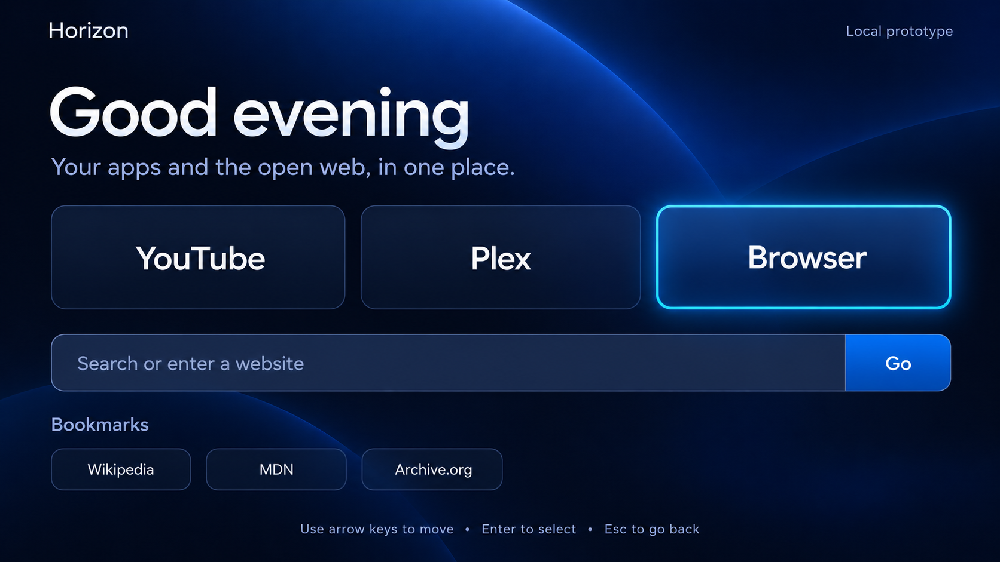

# Horizon for Vizio

Horizon is an experimental, lightweight custom home screen for Vizio SmartCast/Vizio OS televisions. Its interface is plain HTML, CSS, and JavaScript; a small Python companion controller sends authenticated SmartCast requests and can launch Horizon when it observes a TV power-on transition.

Horizon runs as a web page in Vizio's Conjure runtime through SmartCast app ID **17**, namespace **4**. It has been tested on one retail television; it does not replace Vizio Home permanently, and it cannot start itself. Automatic launch requires a separate computer that stays powered, connected to the same LAN, and able to reach the TV.

## Features

- 10-foot launcher layout with lightweight D-pad focus movement, visible focus, OK, and Back handling.
- Configurable app tiles and a reserved browser tile. Streaming app launching and a full browser are not implemented in the page yet.
- Optional performance diagnostics: key event timing, focus update, next-frame timing, FPS, long frames, pending input work, and memory when the runtime exposes it.
- Python standard-library controller for manual launch, power-edge detection, and optional macOS LaunchAgent setup.
- Token stays in the controller's private local auth file. The static page has a restrictive Content Security Policy and cannot connect to SmartCast APIs.

### Preview



This is a design concept, not a capture from the television. No verified on-TV screenshot is included yet.

## Tested device

- Vizio VQD50R-1007
- Vizio OS 1.8.1768.1
- Firmware 86.920.9.3-2
- Conjure launch: app ID 17, namespace 4

The owner confirmed that all four directional buttons, OK, and Back worked in the interface, Home exited to Vizio Home, and navigation was responsive after an optimization pass. A single controlled power-cycle test also confirmed that the controller detected off→on and launched Horizon. These results do not establish compatibility with other models or firmware versions.

## Project layout

```text
frontend/       TV page, static assets, optional diagnostics, deployment root
controller/     local SmartCast controller
tests/          remote test page, guarded launch helpers, previous-version rollback
preview/        older desktop-only concept preview and its image
docs/           setup, integration, Conjure test, and automatic-launch details
```

## Setup

Requirements: Python 3, a Vizio TV reachable over your local network, and an existing SmartCast pairing token. The controller has no third-party Python dependencies.

1. Copy `.env.example` to `.env` and set the TV IP, the Mac/Pi LAN IP reachable from the TV, the private token-file path, and optionally a hosted Horizon URL. Values can also be supplied per command with `--tv`, `--auth-file`, `--host-ip`, and `--url`.
2. This repository does not implement pairing. Use a SmartCast pairing client to start the documented pairing flow, approve pairing on the TV, and enter the displayed PIN in that client. Store its resulting JSON containing `auth_token` outside this repository; for example, `~/.config/vizio-smartcast/auth.json`. Restrict it to the current account (`chmod 600` on macOS/Linux). Never paste the token into `.env`, source files, or the web page.
3. Load the optional shell configuration and check connectivity:

   ```sh
   set -a
   . ./.env
   set +a
   python3 controller/horizon-controller.py status
   ```

   The example `.env` contains IP/path placeholders, not credentials. If your shell does not support this syntax, pass the settings as command-line options.

## Launch manually

To launch the hosted page once:

```sh
python3 controller/horizon-controller.py launch
```

The default is the public HTTPS URL in `.env.example`, so the controller does not start a local web server. To use another hosted page, pass `--url https://YOUR-HOST/`. For local hosting, explicitly pass `--url http://YOUR-CONTROLLER-LAN-IP:8765/horizon.html` and `--host-ip YOUR-CONTROLLER-LAN-IP`. A Home press exits the Conjure session.

The guarded diagnostic test helpers are in [`tests/`](tests/). They send a TV launch only when given `--approved-launch`; read [`docs/CONJURE_TEST.md`](docs/CONJURE_TEST.md) first.

## Cloudflare Pages

For Git integration, use repository root `.` and publish only `frontend/`. Select no framework preset, set the build command to `exit 0`, and set the build output directory to `frontend`. The root `frontend/index.html` and its relative assets are the production website; the controller, tests, and pairing files are outside the publish directory. See [`docs/CLOUDFLARE_PAGES.md`](docs/CLOUDFLARE_PAGES.md).

The current Cloudflare Workers production site is [horizon-vizio.ali-al-anbari.workers.dev](https://horizon-vizio.ali-al-anbari.workers.dev/); the controller defaults to that HTTPS root URL. The Pages instructions above are retained for the Git-integrated Pages deployment path.

## Automatic power-on launch

The controller polls the authenticated read-only power endpoint every three seconds and launches after it sees an off→on transition. It records the current power as a baseline when enabled, so starting it while the TV is already on does not launch the page. Home, input changes, and opening another app do not create a new power edge.

```sh
python3 controller/horizon-controller.py enable
python3 controller/horizon-controller.py watch --dry-run  # recommended first
python3 controller/horizon-controller.py watch            # live launch mode
python3 controller/horizon-controller.py disable
```

For unattended operation, the controller must run on an always-on Mac, Raspberry Pi, or similar device on the same LAN. The macOS LaunchAgent helper writes a local agent definition; it is not installed or enabled by default. See [`docs/AUTOSTART.md`](docs/AUTOSTART.md) for the complete sequence, retry behavior, safe testing, and removal instructions.

Horizon has **not** been configured to start at TV boot. The tested automatic behavior depends on an external always-on controller observing power changes and sending the app ID 17 launch request.

## Limitations and roadmap

- Conjure app ID 17 works on the tested firmware but remains an experimental retail-TV launch route. Vizio Home remains the actual system home screen.
- SmartCast power polling can miss a complete power cycle if the TV API is unreachable in standby. Quick Start behavior varies; Horizon does not change TV settings.
- The TV page cannot hold the pairing token or call the authenticated API. App tile launch needs a carefully scoped companion-controller feature that is not implemented in the frontend.
- The Internet tile is a placeholder, not a browser. Cookies, DRM, text entry, site compatibility, and navigation have not been validated as browser features.
- A public HTTPS static host can serve the page, but the power watcher and SmartCast credentials still need a private always-on controller.

Roadmap: verify more Vizio models, finish a token-free app-launch bridge, evaluate a browser experience within Conjure's webview limits, and improve startup/controller resilience without changing TV firmware or Vizio Home.

## Troubleshooting

- **Pairing/auth failure:** confirm that the auth JSON is readable by your account, has an `auth_token` field, and was paired to this TV. Do not share the file.
- **TV cannot load a locally hosted page:** check `HORIZON_HOST_IP`, same-LAN reachability, and local firewall access to port 8765. A hosted HTTPS URL avoids dependence on the Mac serving the page.
- **Power edge is missed:** run `watch --dry-run`, confirm the TV reports power transitions, and check whether its SmartCast API is reachable in standby. Network errors are treated as unknown, not as power-off.
- **No page after launch:** confirm the URL is reachable from the TV and that the TV remains on the same network. Press Home to leave the Conjure page.

## Contributing

See [`docs/CONTRIBUTING.md`](docs/CONTRIBUTING.md). Keep credentials and TV-specific private settings out of commits, retain the restrictive page CSP, and test navigation without connecting the frontend directly to the authenticated SmartCast API.

## Acknowledgements

The implementation was informed by public SmartCast protocol and Conjure deployment references, including [`get-air/vizio`](https://github.com/get-air/vizio), [SocialVibe's Vizio web-app deployment notes](https://github.com/socialvibe/truex-ctv-web-reference-app/blob/develop/platforms/Vizio/README.md), and [`smartcast-backdoor`](https://github.com/vindeckyy/smartcast-backdoor) research. Horizon does not include exploit code or copied third-party implementation code. The `get-air/vizio` and `smartcast-backdoor` repositories identify MIT licensing; we found no license for the cited SocialVibe repository, and therefore use it only as an attributed documentation reference. See [`docs/THIRD_PARTY_NOTICES.md`](docs/THIRD_PARTY_NOTICES.md).

## License

Horizon for Vizio is distributed under the MIT License; see [`LICENSE`](LICENSE). Vizio and SmartCast are trademarks of their respective owners. This project is independent and is not endorsed by Vizio.
